# 2026 第二届中国 GEO 大会全天深度复盘（REVIEW）

> **时间地点**：2026 年 11 月 21 日（周六）08:29–18:36（深圳，含晚间自选场）  
> **参会规模**：现场 500–600 人（近 60% 来自广东省外，较 4 月北京首届约 200 人翻倍以上），官网 Day 1 议程共 14 个时段（13 场主题演讲 + 1 场圆桌，另收录现场 4 位 5 分钟快分享），会前收集 107 个核心问题，全程去商业化纯干货学习。  
> **复盘依据**：本报告基于大会官网（`hui.ailingdaoli.com`）Day 1 议程校正全部嘉宾姓名与头衔，结合白昼四大场次（上午① `s1`、上午② `s2`、下午① `s3`、下午② `s4`）共计 4 份完整语音逐字稿（约 14 万字）与 5 份飞书智能纪要及 5 张总结导图交叉核校而成；所有事实、数据、原话与时间戳均**以逐字稿为准**，语音识别存疑处已逐一标出。

---

## 一、全天议程与嘉宾地图（白昼四大场次）

| 场次 | 议程时段 | 嘉宾 / 组织（按官网议程校正） | 身份核实状态 | 官网议程主题 / 一句话核心命题 |
|---|---|---|---|---|
| **上午场①** | `08:30–08:45` | **姚金刚 · 乔向阳（乔木）**（GEOFlow 创始人 / 知名 AI 自媒体人） | 已按议程核实 | **先导课**：107 个会前问题最关心**效果评估、海外 GEO、数据监测**；布置 30 秒写 1 个问题+邻座互答升级版费曼作业 |
| | `08:45–09:15` | **任强**（北京日报社京报移动副总经理、北京日报智源GEO负责人） | 已按议程核实 | **《主流媒体在 AI 答案时代的内容价值与可信表达》**：媒体将话语权延伸到 AI 答案层；推出「对读者+对大模型」双通路编发、**智源 GEO 2.0** 与**蜂巢计划** |
| | `09:17–09:47` | **拔刀刘**（AIDSO 爱搜 AI 合伙人） | 已按议程核实 | **《数据底座驱动 GEO：从监控到增长的实战方法论》**：GEO 终局是数据驱动精细化运营；监测占比 25%–30% 才是领导者；**7 月 AI 电商精准归因**开启红利（点击率 6.45%、转化 37%） |
| | `09:49–10:19` | **张栖铭**（BotLearn 联合创始人） | 已按议程核实 | **《AI 原生研发指南：如何构建 AI Native 团队》**：人脑是最大瓶颈（80% 等读/等输），不能在旧职能上硬加 AI；**按上下文分工**、人管两头、用虚拟人格自动验证 GEO |
| **上午场②** | `10:30–11:00` | **哥飞**（海外 SEO 专家 ·「哥飞的朋友们」社群主理人） | 已按议程核实 | **《如何另辟蹊径同时获取 SEO 和 GEO 流量》**：趁 GPT 抢谷歌心智窗口期，用**“新词无人擂台”零外链当天建站**拿 ChatGPT（付费率 3.4%）与谷歌流量；拆解三类爬虫 |
| | `11:02–11:32` | **谭少卿**（Floatboat 创始人兼 CEO） | 已按议程核实 | **《如何打造属于自己的超级 Agent》**：企业业务全跑在大厂 Agent 上会被取代；用 **GUI 前端 + 原生 Workflow 后端**的 Agent OS 沉淀专属业务路谱，开源工作台源码 |
| | `11:34–12:04` | **张伟方**（宁波日报报业集团副总编辑、甬派董事长） | 议程已核实（自述履历与议程存在差异，待确认） | **《城市语料如何赋能 GEO，城市语料行业标准建设启动暨第三届全国 GEO 大会召开城市发布》**：依托**天一语料**等落实“被看见-被引用-被推荐”；坚持**投 1 万换 1.5 万订单**、合规与**组织隔离** |
| **下午场①** | `14:00–14:30` | **刘树勋**（智推时代联合创始人） | 已按议程核实 | **《品牌企业如何做好 GEO：内容建设与增长实践》**：品牌方**六大诉求、四大 KPI**、**“3+1”攻防词**；提示知乎/抖音引用剧烈迁移，“中力出奇迹”正迈向“大力出奇迹” |
| | `14:32–15:02` | **艾奇先生**（艾奇在线创始人 · 资深互联网营销实战专家） | 已按议程核实 | **《从关键词到高维场景，AI 时代 GEO 全场景词包策划方法论》**：从机械长词转向高维场景事实生态；**推荐得分 = 质量 S × 场景相关性（入场券） × 信源可信度**；四阶段 × 三维度 × 三圈层 |
| | `15:04–15:34` | **苍何**（微软 MVP · 前排 GEO 研究院主任 · 前排科技 CTO · AI KOL） | 已按议程核实 | **《GEO 落地服务实战》**：低价接精细化单至今仍亏；拆解**五步交付闭环**、**大模型四大排毒**（来源/指纹/交叉/反垃圾）与“100 词拆 10 组换骨架”破指纹 |
| | `15:36–15:56` | **岳琦**（每经科技首席产品官（每日经济新闻旗下）· 资深财经媒体人） | 已按议程核实 | **《当 GEO 成为信任基建，品牌怎么做专业媒体式传播？》**：全国完整交付能力**不足 50 家**、大客 3 人配 1 家；GEO 仍处 RAG 层难短期获客，必须从**流量叙事转向证据叙事**与长案陪跑 |
| | `15:58–16:28` | **圆桌：吕推 / 张莹莹 / 安美奇（主持：岳琦）** | 已按议程与现场大屏核实 | **《GEO 圆桌分享》**：吕推（芥末推创始人 · 鲸戈环球创投董事长）、张莹莹（成长最美创始人兼CEO · HOCOMO传媒创始人兼CEO）、安美奇（答案时代创始人 · 十年互联网营销增长操盘手）；放弃排名执念转向**被推荐权（200 字推荐差 10 倍）**，回归**产品与证据链** |
| **下午场②** | `16:40–17:10` | **杨攀**（Bilink 创始人 · 硅基流动前联创） | 已按议程核实 | **《从 AI 发展趋势中寻找新机会》**：AI 拉平功能制造严重供给过剩，**Token 兼具生产资料与生产力**；基于 DeepSeek Harmony 做发行版，押注**20% 活数据/物理接口/基础软件**或用 Agent 交付 |
| | `17:12–17:42` | **高军**（媒介匣创始人 & CEO） | 已按议程核实 | **《从优化到治理：全域 GEO 时代的品牌营销操作系统》**：**碳硅共存“让用户喜欢、让 AI 信任”**；80% 忽视官网/百科/征信、60% PR 口径矛盾；建议**把 1/3 预算给微信小微**，跨 20 平台差异 <20% |
| | `17:44–18:14` | **陈峥**（欧博东方 CEO） | 已按议程核实 | **《经营增长视角下的 GEO：从战略到组织落地》**：大词失效、**80% 流量进细分场景**；9 月严肃赛道改**按时间轴分层赋权**；**SEO 终局是排名，GEO 开局是采信**，67% 选品前求助 AI |
| | `现场加场（5 分钟/人）` | **快分享（4 位）**：周小乔（云溪）、福波（阿里云万网·万小智）、周小鸟、杭州张总 | 杭州张总等全名待核实 | 免费开放云溪 GEO 系统与 15 元 IP；万小智开放 2 万+ AI 建站托管能力；痛点-困境-方案三步攻略；**智能体一问必知假排行榜是一辈子埋雷** |

---

## 二、贯穿全天的十大主线

1. **GEO 价值与本质定位**：国内生成式 AI 用户达 7 亿、豆包月活超 4 亿、67% 消费者选品前求助 AI。“AI 答案里没有你＝市场没有你”，价值链演进为“被看见→被引用→被推荐”；圆桌更指出，AI 直接给结论而非列表，200 字深度正向推荐与单纯露名的商业价值相差 10 倍。
2. **大模型如何选内容**：
   - 偏好五大属性：来源权威、表达清晰（消灭“市发改委”等歧义简称）、本地化、结构化、平台归属（任强）；
   - 推荐公式：`得分 = 内容质量(S) × 场景相关性(100分入场券) × 信源可信度(100%)`（艾奇先生）；
   - 四大排毒机制：来源分级、机器指纹（同套“1、2、3”骨架直接打标）、多源交叉验证、反垃圾持续升级（苍何）；
   - 2026 年 9 月起医疗、法律等严肃赛道已由单纯“趋新性”转为**按时间轴（1 年/半年/3 个月/30 天）分层赋权**（陈峥）；
   - 海外 ChatGPT 在用户点击推荐前约半小时，会派 `ChatGPT-User` 爬虫二次现场抓验网页体验与可用性（哥飞）。
3. **方法论高度收敛**：全天 7 套实战流程共同收敛到“**诊断摸底 → 挖词/高维场景 → 官网与结构化知识库底座 → 差异化多模态内容与半自动分发 → 真实监测反哺调优**”。
4. **选词与高维场景**：从抢 20% 大词转向占 80% 流量的带记忆细分场景（陈峥）；用“3+1”攻防词防守竞品幻觉并进攻品类（刘树勋）；用“三高原则”区分本体词与高难转化入口词（苍何）；海外专攻每天占 15% 的无人守擂新词（哥飞）；用痛点-困境-方案写定制攻略（周小鸟）。
5. **内容形态与权威信源**：PC 官网、百度百科与爱企查征信迎来价值大逆转；北京日报推出“给读者+给大模型”双通路编发与蜂巢计划，宁波落地“天一语料”；一内容可拆文字/PDF/视频三模态；抖音被 AI 引用与粉丝量相关性仅 0.06%–0.09%，40% 属于一年前存量视频。
6. **监测体系与效果衡量**：指标从提及率升级为“提及率+正向占比+占位+声量份额+转化”；由于 6 个维度叠加，甲乙日均监测量达 1 万–2 万次；领导者将 25%–30%+ 预算拆给独立监测“裁判员”。但国内缺对标海外 18 亿美元 Profound 的主流平台，封闭私域使长链路归因仍是行业难题。
7. **AI 电商与海外实战**：7 月后豆包、千问、元宝均已跑通电商精准归因——豆包专区实测点击率 6.45%、点击购买转化率 37%，20–40 字五要素标题更易弹卡；海外测试站首日从 GPT 获 600 访客、17 单（221 美元）、付费率 3.4%，明年出海重点在 GEO + ChatGPT GEM 广告与跨境复合交付。
8. **服务商经营与洗牌避坑**：全国两三千家服务商里能完整交付的不足 50 家；低价接精细化单且无限换词导致亏损（苍何）；大客至少需 3 人配 1 家，而中小客 1 人管 3 家；必须用免费诊断筛选长期主义客户、招抗压运营、严禁过度承诺、预判大厂闭环趋势转向全案陪跑咨询。
9. **AI 与 Agent 时代大趋势**：AI 把软件工程拉平到及格线，外壳不再值钱，99% 软件将成自用 MVP；**Token 是史上首个兼具生产资料与生产力的要素**；创业应避开被模型吞掉的 80%，押注“为 Agent 提供活数据/物理接口/基础软件（20%）”或“用 Agent 交付服务”，同时切 1/3 预算提前布局将覆盖 11.94 亿人的微信小微，并按上下文重组团队、搭建 GUI+Workflow 专属工作台。
10. **合规红线与不可编造的证据链**：从情绪化流量叙事走向可查证的证据叙事；严禁发虚假排行榜（“AI 问不出但智能体一问必知”，给客户埋一辈子的雷）；企业统一全渠道身份消除 60% PR 自相矛盾漏洞；把 GEO 从推广部纳入产品部，先做好产品与交付本身。

---

## 三、六大核心观点碰撞（分歧与边界）

| 碰撞议题 | 一方观点 | 另一方观点 | 复盘结论与适用边界 |
|---|---|---|---|
| **1. 要不要追 TOP 排名？** | 刘树勋、拔刀刘：品类占位排名前几（Top1/Top3）直接决定点击与转化 | 安美奇、陈峥：放下排名执念！AI 给结论不给列表，200 字正向推荐价值差 10 倍，GEO 开局是采信 | 电商弹卡与刚性品类对比看重前排，但品牌长期建设更应衡量声量份额（SOV）与推荐深度 |
| **2. 短期 ROI vs 长期心智** | 拔刀刘（电商 37% 转化）、张伟方（投 1 万回 1.5 万订单）、哥飞（首日出单） | 岳琦（短期获客不现实，应走品牌/PR 长预算）、高军（陪跑 3–5 年非老鼠药） | 标品电商与海外独立站交易链路短可算实时 ROI；大宗 B2B/医疗/汽车决不能签“7 天保效果”对赌 |
| **3. 大力出奇迹 vs 反堆稿** | 刘树勋：从 1 篇迈向 10–1000 倍“大力出奇迹”，用预测清单控本 | 陈峥、艾奇先生、苍何：批量水稿和同套“1、2、3”骨架会被机器指纹拉黑或判为投毒 | 量级提升必须建立在“分组换提示词+换骨架+真实事实”上，绝非同质水文堆量 |
| **4. 效果到底能不能归因** | 拔刀刘（口令码/官方归因）、高军（GA4/百度统计倒推）、哥飞（官网爬虫 IP 日志） | 圆桌（大模型问答属封闭私域无用户旅程）、岳琦（三端不同且部门割裂） | 站内闭环或 Web 独立站可精准归因；跨长决策周期的线下/App 成交只能靠“独立监测+边缘统计” |
| **5. 单入口聚焦 vs 全域一致** | 拔刀刘（先打穿豆包手机端）、高军（立刻把 1/3 预算调向微信小微） | 高军（跨近 20 平台差异 <20% 反对拆卖）、陈峥/福波（无 AI 友好官网底座连发党媒都难采信） | 官网/百科/一致口径是全平台共享的“体”（地基），豆包电商与微信小微是预算放大的“用”（出口） |
| **6. 放手 AI 跑 vs 真人一线感** | 张栖铭（人脑是瓶颈，千万别逐字读输出，虚拟人格自动化测）、谭少卿（AI 算力代人力） | 岳琦（反对 AI 模拟人味儿，必须真人一线测评）、苍何（养号半自动与真用户模拟） | 调研、拓词、排版与自动化监控交给 AI 工作流；真实测评体验、事实证据与关键签审必须由人把关 |

---

## 四、高密度数据墙精选（逐字稿核实）

- **用户与趋势大盘**：生成式 AI 用户 **7 亿**（张伟方 / 任强等多次提及大盘）；豆包月活 **4 亿+**（艾奇先生）；微信小微内测日活 **3000 万**，全量将覆盖 **11.94 亿**（艾奇先生/高军）；**67%** 中国消费者选品前问 AI（陈峥）；**80%** 流量已转向细分场景（陈峥）。
- **市场与服务生态**：上半年公开招标 **3.4 亿元**、单标最高 **1800 万元**（苍何）；某 3C 厂商明年单 GEO 预算近 **1 亿元**（陈峥）；全国两三千家服务商中完整交付 **不足 50 家**（岳琦/杭州张总）；大客需 **3 人配 1 家** vs 小客 **1 人管 3 家**（岳琦）；海外监测标杆 Profound 估值 **18 亿美元**，而目前客户 **90%** 预算仍在社媒达人营销（张莹莹）。
- **监测、平台与企业诊断**：领导者监测预算占 **25%–30%+**，甲乙日均监测量 **1 万–2 万次**（拔刀刘）；跨近 20 平台差异率 **<20%**（高军）；**80%** 服务商忽视官网/百科/征信、**60%** PR 口径矛盾（高军）；抖音粉丝与被引用相关性仅 **0.06%–0.09%**，**40%** 被引用视频发布超 1 年（拔刀刘）；搜索引擎占位链接与 AI 引用信源重合率最高仅 **0.65%**（陈峥 PPT）。
- **变现、电商与出海实测**：豆包运营专区单周 **70 万+**、**1 万+** 单，卡片点击率 **6.45%**、购买转化率 **37%**（拔刀刘）；渔具品牌豆包订单 10 月翻 **30 倍+**，ESG 教育 Kimi 投 **1 万**回报近 **100 倍**（刘树勋）；海外零外链新站首日 GPT **600 访客/17 单/221 美元**，付费率 **3.4%**（谷歌 **2%**、单访客 **1.36 美元**），国庆 **49 人**实验 **41 人**拿 GPT 流量（哥飞）。
- **AI 与 Agent 宏观冲击**：Steam 每 **6 分钟**上新 1 款游戏，新 App 上架翻番而下载仅涨 **2%**，**99%** AI 软件是自用 MVP，未来大模型占软件 **80%** 收入，创业策略每 **3 个月**重审，Agent 红利放大 **1 万倍+**（杨攀）；个人 AI 异步产出涨 **10 倍+**，对话框 **80%** 时间在等人阅读与输入（张栖铭）；**6–8 成**用户用不好 Skill/Codex，自研底座在对比基准上提效 **13.6%**（谭少卿）。

---

## 五、飞书 AI 总结导图

以下 5 张结构化总结导图直接导出自大会 5 份飞书智能纪要白板（`whiteboard`），另有 11 张分主题 AI 生成配图已同步接入交互学习站对应讲者页与「导图图集」页面（图中个别文字为飞书 AI 原生语音转写产物，如将 `GEO` 识别为 `绩优/GU`，阅读时可对照术语纠错表）。

### 1. 上午场①（先导课 · 任强 · 拔刀刘 · 张栖铭）
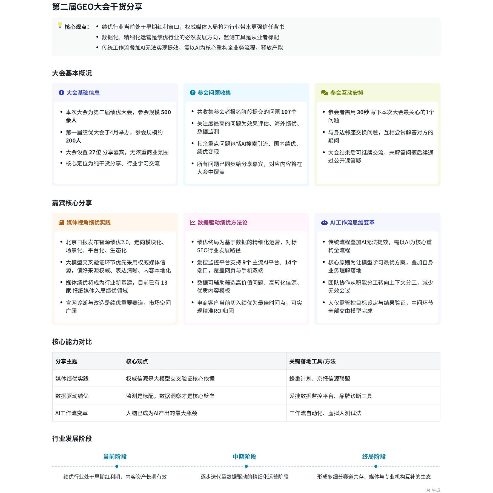

### 2. 上午场②（哥飞 · 谭少卿 · 张伟方）
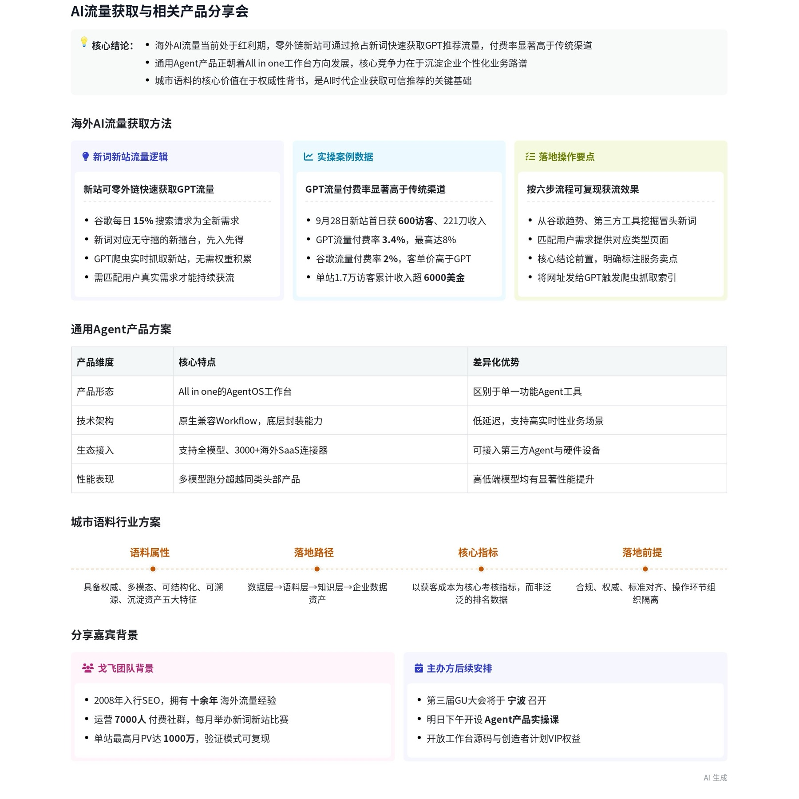

### 3. 下午场①（刘树勋 · 艾奇先生 · 苍何 · 岳琦 · 圆桌）
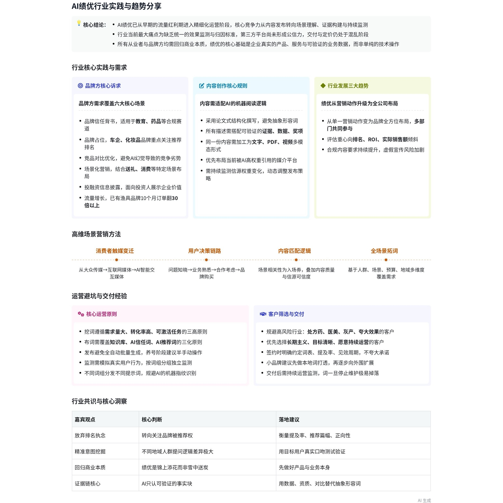

### 4. 下午场②（杨攀 · 高军 · 陈峥 · 四位快分享）
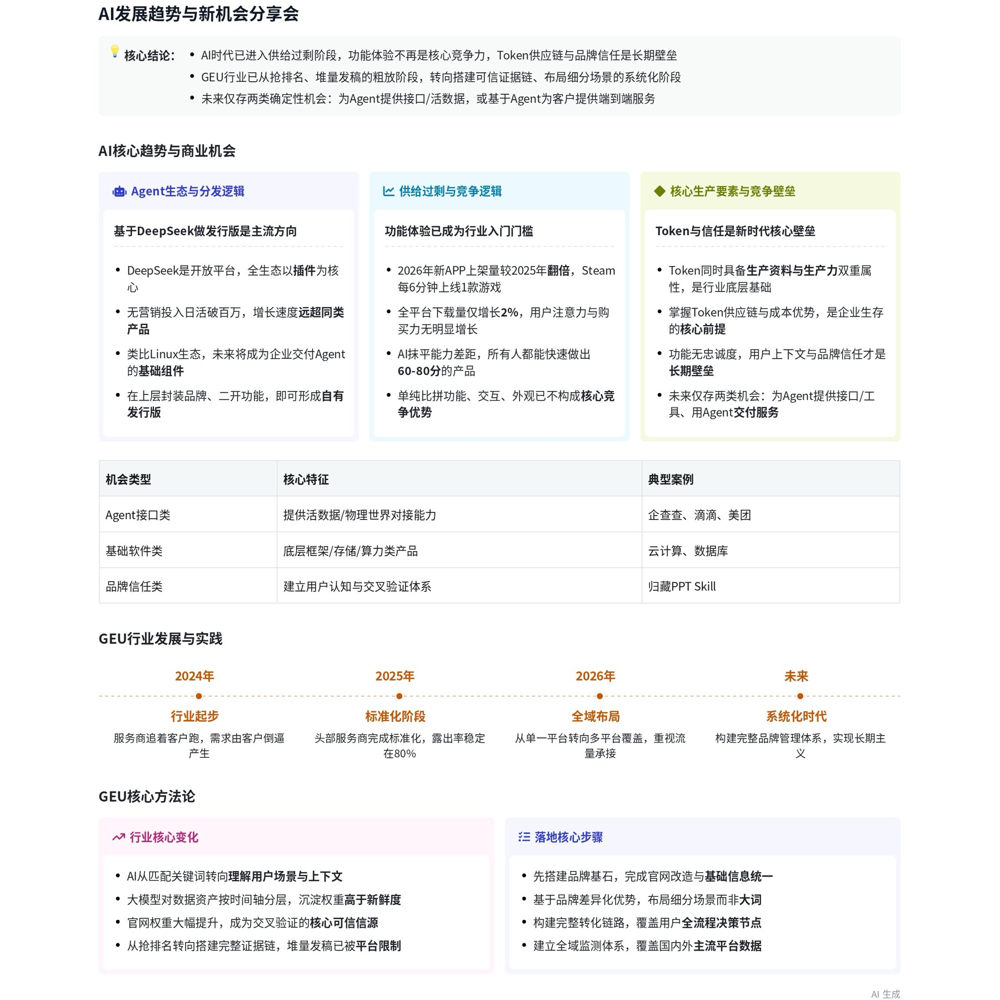

### 5. 专项补充导图：杨攀《从 AI 发展趋势中寻找新机会》
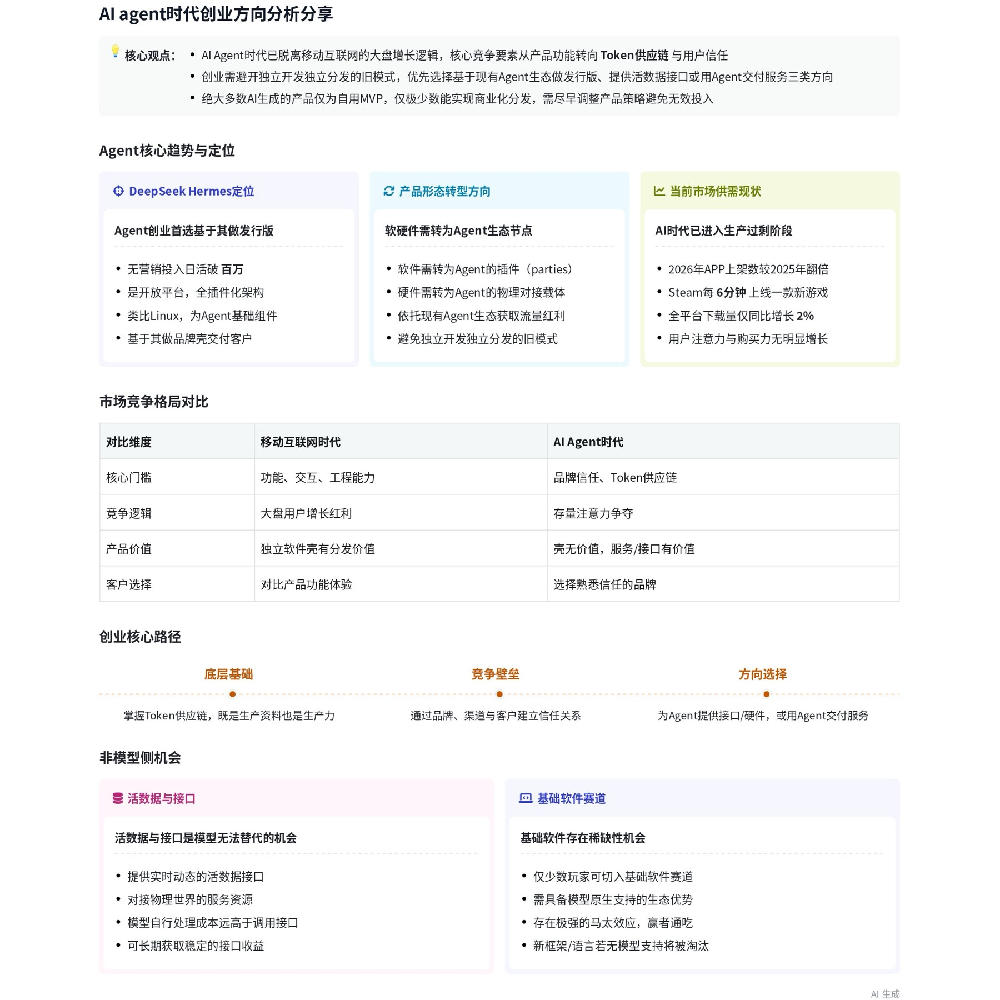

---

## 六、分场次嘉宾核心要点与差异备忘

### 上午场①（`08:29–10:15` · 妙记 `obcnc567j78cy28tdqz15d52`）
1. **任强（北京日报社京报移动副总经理、北京日报智源GEO负责人）**：详解 7 亿 AI 用户与中宣部“高质量清洁语料”背景；提出大模型交叉验证与五大偏好；发布**智源 GEO 2.0（四化）**与**蜂巢计划（采蜜/酿蜜/授粉）**，推行“双通路”编发并开放 74 年历史报库（一期入库 203 万条，纪要误记“203 万期”）。
2. **拔刀刘（AIDSO 爱搜 AI 合伙人）**：提出“监测是标配，洞察才是壁垒”；用 3 年社媒搜索映射 AI 热度，分行业/平台/端口监测（119 国海外工具）；拆解 7 月后 AI 电商精准归因、口令码弹券法与 13 端口 1800 回答商品卡片结构。
3. **张栖铭（BotLearn 联合创始人）**：从 24 小时多电脑异步十倍产出到书籍播客踩坑复盘（反对“油车塞手机”式叠加），提出**按上下文分工**、五类复合角色、人管两头、用虚拟人格测豆包，并首发《GEO》图书配套实战课。

### 上午场②（`10:27–11:31` · 妙记 `obcnc5izqw5259lw5fn8d735`）
1. **哥飞（海外 SEO 专家 ·「哥飞的朋友们」社群主理人）**：依托 7000+ 人社群与百人实战，提出“新词无人擂台”；拆解谷歌 15% 每日新词与 ChatGPT 搜索占谷歌 20% 背后的互惠生态，详述 `GPTBot` / `OAI-SearchBot` / `ChatGPT-User` 分工、9月28日 vs 10月7日 vs 10月19日（需求错配 0 单）对照试验。
2. **谭少卿（Floatboat 创始人兼 CEO）**：核实“赵鑫”实为串场口误，全段均为谭少卿发言。阐述企业核心业务不能跑在大厂平台，通过“GUI 工作台 + 原生 Workflow 后端”、AI 浏览器与 3500+ 连接器打造自主业务路谱，开放 GEO 创收工作台源码与创造者计划 VIP。
3. **张伟方（宁波日报报业集团副总编辑、甬派董事长）**：拆解“被看见-被引用-被推荐”与城市语料五大属性、六步闭环，落地宁波“天一语料”并预告第三届宁波大会；提出“现有优化中转站未来可能被真实城市语料替换”预警，死守**投 1 万换 1.5 万**与**组织隔离**。*(注：现场口播自述履历与官网议程身份存在差异，建议向主办方进一步确认)*

### 下午场①（`13:59–16:20` · 妙记 `obcnda5c64t63zzjdmiq79v6`）
1. **刘树勋（智推时代联合创始人）**：从 ESG 100 倍 ROI 出发，系统归总甲方 6 大需求（含 HIROX 室内健身赛事场景占位，非服饰品牌名）、4 个 KPI、公关/市场各 30% 签约现状，提出“论文式写法 + 一内容三模态 + 3+1 攻防词 + 已收录/预测清单”。
2. **艾奇先生（艾奇在线创始人 · 资深互联网营销实战专家）**：构建“推荐得分公式 + 决策四阶段 + 运营三维度 + 产品三圈层”完整框架，揭示 AI 自动补全记忆场景机制，现场演示用全场景拓词 Skill 从 20 词扩至 100+ 维度，强调不接 1–2 万小单。
3. **苍何（微软 MVP · 前排 GEO 研究院主任 · 前排科技 CTO）**：坦陈 6 亿估值散伙后再做精细化 GEO 仍亏损的教训；系统给出五步交付、三高挖词、三化布词、养号半自动推词、四大排毒与分组换骨架防指纹，以及五条选客与抗压管理红线。*(已核查纪要“说话人 3”实为苍何本人，无联合讲者)*
4. **岳琦（每经科技首席产品官 · 每日经济新闻旗下）**：给躁动市场泼清醒冷水，亮出完整交付不足 50 家与大客 3 人配 1 家成本账，划出“负责任 GEO 三圆交集”，主张用“证据叙事”与“财经垂类百科语料”服务品牌部长期陪跑，应对行业去污名化更名为“AI 传播基建”。
5. **圆桌对话（吕推、张莹莹、安美奇，主持：岳琦）**：围绕出海清旧账、单生态位聚焦、不丢主业预判大厂闭环、地区口吻意图视角、内容衰退与精细数据运营、SOV 取代排名执念及私域归因困境深度交锋，收官于回归产品、生意与真实证据链。

### 下午场②（`16:41–18:36` · 妙记 `obcndcf62diyh41zg9o99g22`）
1. **杨攀（Bilink 创始人 · 硅基流动前联创）**：穿透供给过剩与软件壳价值归零，给出 Token 双重属性、N-1 上游供应链、下游品牌信任、DeepSeek Harmony（亦作 Harness，待核实）发行版、3 个月产品止损线及 80/20 软件格局判断。
2. **高军（媒介匣创始人 & CEO）**：凭借百余家上市公司服务与国内首个 GEO 标准编制经验，强调“左右逢源（让用户喜欢、让 AI 信任）”，揭露 80% 基建盲区与 60% PR 矛盾，提出看病式四步闭环与五维品牌表达，强烈建议立刻切 1/3 预算至微信小微。
3. **陈峥（欧博东方 CEO）**：带来 2000 家客户一线洞察——大词失效、9 月起时间轴分层赋权、官网权重飙升、67% 决策后段全链路断流、面向消费者/加盟商/招采/投资者的多元疑问，依托“欧若拉”四维数据源与全国拟人化 IP 监测，反对批量水稿（SEO 终局排名 vs GEO 开局采信）并预告 15 年跨境复合出海交付。
4. **快分享四位嘉宾**：**周小乔**（云溪新疆算力支撑免费 GEO 系统+城市官网+15 元/月 IP）、**福波**（万小智 2 万+ AI 建站全托管能力开放与采集 API 招募）、**周小鸟**（搜索三代进化与“痛点-困境-方案”单点攻略）、**杭州张总**（智能体 1 人管 5 项目转型全域传播，力陈假排行榜给客户埋一辈子雷）。

---

## 七、语音识别纠错与术语说明（节选）

由于飞书语音识别把行业英文缩写、人名机构名和专业术语转写了大量谐音错字，本复盘与交互网站已全部依据官网议程与上下文核校规范化（仅在“术语与纠错页”保留原误写对照以便追溯原声）：
- **`GEO` 常见误识**：`基优 / 绩优 / 集优 / 吉优 / 机油 / 肌油 / GU / GO / GEU / AGU / PU`。
- **人名与机构名校正**：`张新敏(Oraka) → 张栖铭(BotLearn)`、`戈飞 → 哥飞`、`拔刀流(爱搜 AI) → 拔刀刘(AIDSO 爱搜 AI)`、`谭少青(Frobot/Flowbot) → 谭少卿(Floatboat)`、`昌河(前白科技) → 苍何(前排科技/前排 GEO 研究院)`、`艾琪(爱奇在线) → 艾奇先生(艾奇在线)`、`安美琪 → 安美奇`、`杨刚 → 杨攀(Bilink)`、`陈征(沃东方) → 陈峥(欧博东方)`、`媒介侠 → 媒介匣`、`乐欣 → 岳琦(每经科技)`、`智能时代联创 → 刘树勋(智推时代)`、`任总 → 张伟方(宁波日报报业集团)`。
- **其他高频误识**：`彩信 → 采信`、`城市铝料 → 城市语料`、`豆包 DC/DP → 豆包`、`提寄率/提机率 → 提及率`、`首通率 → 首推率`、`盘卡 → 弹卡`、`销量化 → 向量化`、`机械化运营 → 精细化运营`、`趋心性 → 趋新性`、`政治场景 → 真实场景`、`头图了 → 投毒了`、`原则化 → 原子化`、`HIROX（演讲中指室内铁人三项类健身赛事，非服饰品牌名）`。

---

## 八、现场照片精选

从享像派大会官方照片直播（11 月 21 日主会场筛选 **88 张**直拍精选，已自动剔除晚间非本大会之“亚太肿瘤学”场次照片）挑选代表性现场画面与大屏 PPT 实拍，完整图集可在交互学习站「导图图集」或对应讲者详情页浏览。

> **现场照片**：[享像派照片直播相册](https://www.xxpie.com/m/album?id=6afeda1730285548f60b41b5&source=SHARE_LINK&r=9951) · 摄影 文化致胜、刘宇琪

### 照片核实带来的更正
- **机构与人物背景**：高军早期创立公司原文为 **禾众广告**；杨攀履历补全 **融云 RongCloud 联合创始人 & 前 CTO**，其播客大屏原文为 **《Next Token \| 词元之外》**；圆桌大屏完整头衔补全为 **吕推（芥末推创始人 · 鲸戈环球创投董事长）、张莹莹（成长最美创始人兼 CEO · HOCOMO 传媒创始人兼 CEO）、安美奇（答案时代创始人 · 十年互联网营销增长操盘手）**。
- **核心术语与产品名**：高军核心标语原文为 **「GEO，用户成势 天下未定」**；陈峥智能体原文为 **欧若拉（Euler）**；张栖铭所举软件逆向与重写案例工具原文分别为 **REA** 与 **Craft Anything**（1 人 → 7 款）；艾奇先生旗下产品矩阵大屏原文为 **艾课网 / U渠道 / 艾聘网 / 艾奇GEO**。
- **关键数据口径**：陈峥 PPT 实测为谷歌（**0.65%**，11/1,698）、百度（**0.21%**，4/1,950）、必应（**0.57%**，11/1,919）占位链接与 AI 平台引用信源重合率（原口播转写误作 6.5% 且口径混淆）；谭少卿 PPT 原文标注 **3500+ 连接器**（口述约 3000 多家）。

### 精选现场实拍

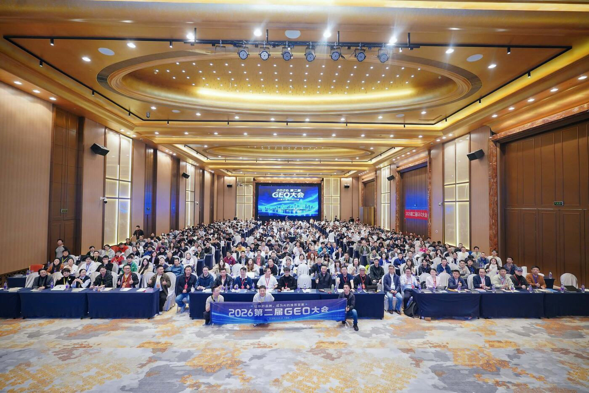
*上午场收尾全场大合影：近 600 名参会者在「2026 第二届 GEO 大会：让你的品牌，成为 AI 的推荐答案」横幅前比赞留念*

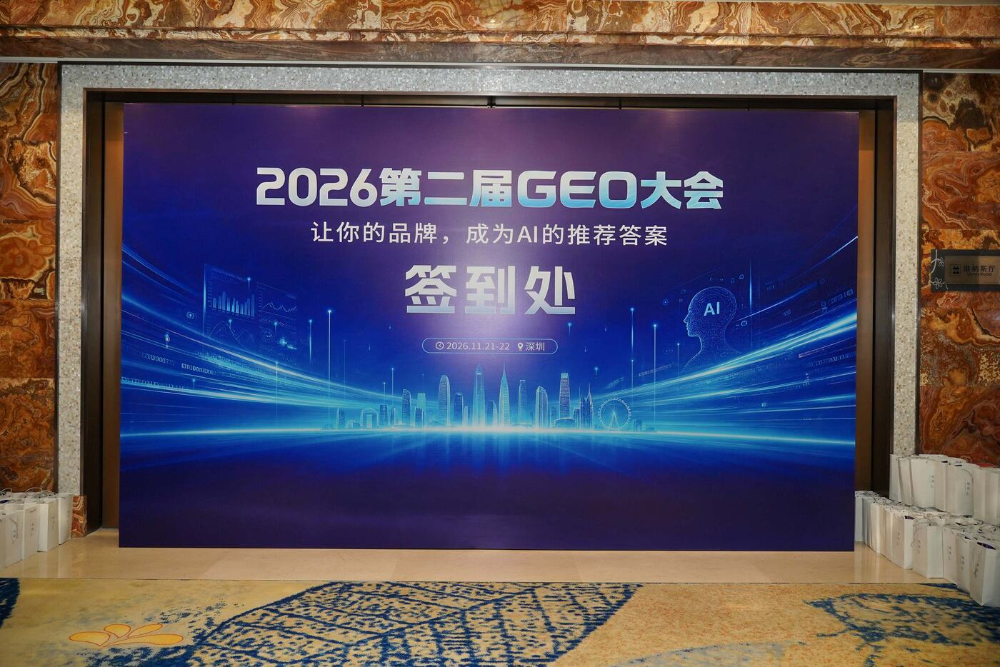
*深圳会场「2026第二届GEO大会」主视觉签到墙与两侧整齐码放的参会伴手礼袋（维纳斯厅外）*

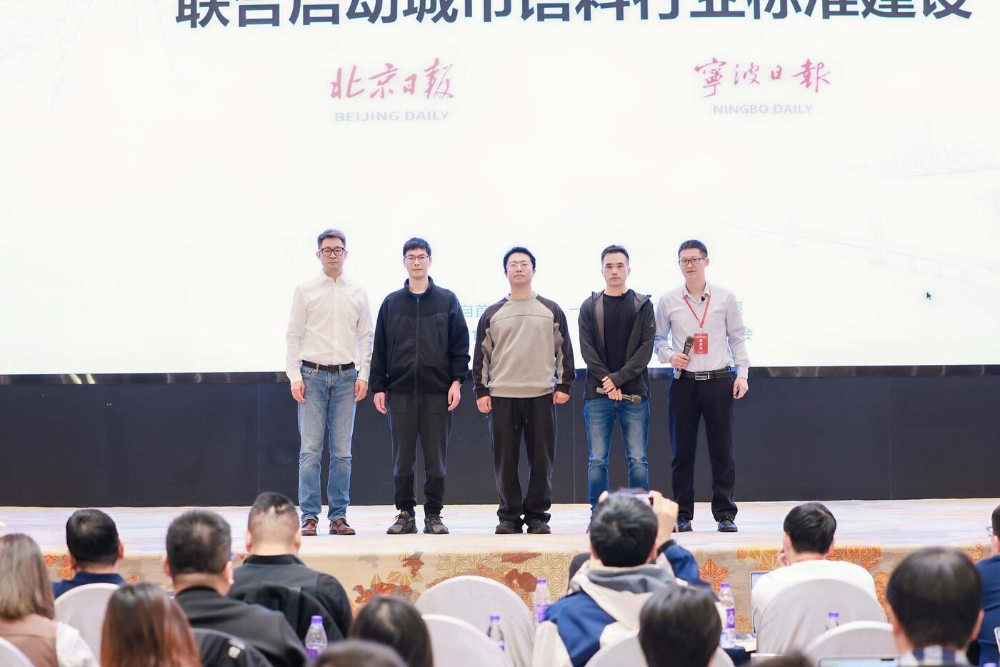
*「联合启动城市语料行业标准建设」仪式同台合影：北京日报与宁波日报五位代表同台（右一为随后主讲的宁波日报报业集团代表张伟方）*

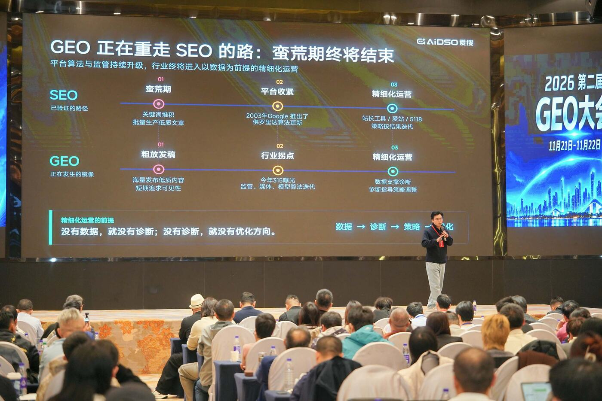
*拔刀刘以 SEO 三阶段演变镜像论证 GEO 终局必将走向基于数据的精细化运营*

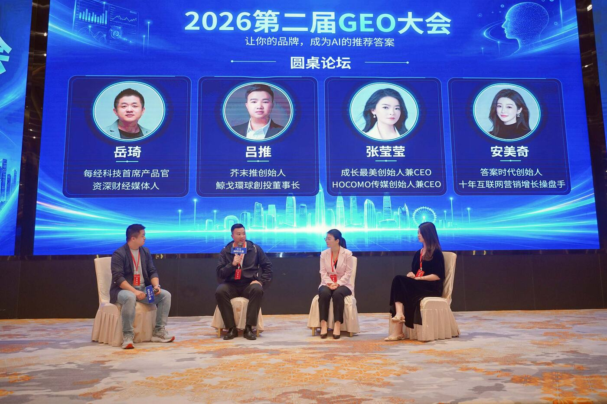
*「GEO 圆桌分享」台上嘉宾近景合影（左起：主持岳琦、吕推发言、张莹莹、安美奇），大屏同步呈现四位嘉宾头像与机构头衔*

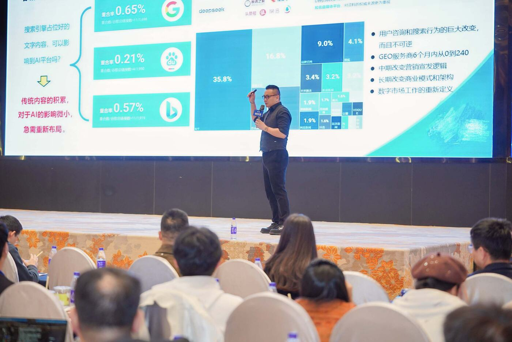
*陈峥展示谷歌（0.65%）、百度（0.21%）、必应（0.57%）传统搜索占位与 AI 引用信源重合率及 DeepSeek 信源分布*

---

## 免责声明

本复盘所有内容整理自 2026 年 11 月 21 日第二届中国 GEO 大会官网议程与白昼四大场次飞书智能纪要、语音自动转写逐字稿，可能存在口播数字、产品拼写或个别身份自述差异标注的识别误差；文中已对存疑项统一标注“待核实”，完整原声请点击各条时间戳跳转飞书妙记核对（需具备对应飞书空间查看权限）。
